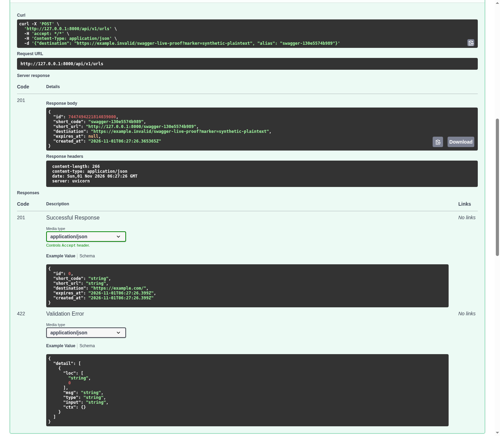
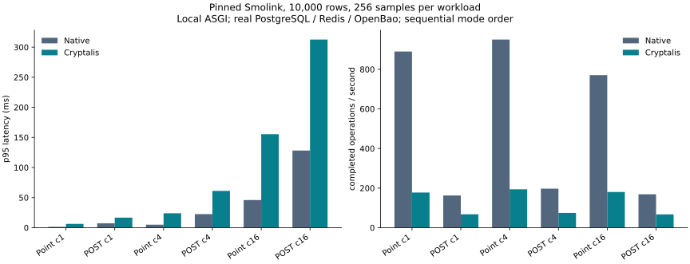

# Installed Cryptalis preview: API, encryption and measured costs

This separate fresh clone starts from Smolink
`498d24bae999ed53ad85e1c1f1a09ea7fa151aa4`. Demo code is committed at
`2a6622311359f470412c22c53907b5fe3623a370`. The original backend application,
models, queries and route handlers have **zero changed files**. The normal wheel
installation is Cryptalis `0.1.0a1`, built from library inputs committed at
`655d52271d90effb4df918a9547f61c89055fbc7`, with SHA-256
`eedecae8fd72a06bdf8ed95bd0aae377cabdfd51df325c50463f4f4f4b65060a`.

The library remains an unqualified research prototype. This report describes
executed bounded behavior, including failures and unmeasured properties. It is
not production qualification or a public release.

## 1. The existing API works

The unmodified `POST /api/v1/urls` route returned `201` through the original
Swagger **Try it out** screen, served by Uvicorn over a real loopback connection.
The route's ordinary response contains the authorized plaintext destination.
The original `/health` and `/openapi.json` also returned `200`.

[Raw request/response](evidence/swagger-protected.json) records the exact Python
JSON integer. The browser's JavaScript display rounds Smolink's large Snowflake
ID; that existing UI behavior is not a change to the stored/application integer.
This revision implements URL creation. URL read/update/delete and redirect routes
are planned. Updates below use the original repository/ORM, not invented endpoints.
Mail/OAuth flows were not exercised in this Smolink presentation.

## 2. Encryption, current edits and removal work within this scope

The manifest protects **only `Url.destination`**, as storage-only VARCHAR(2048)
in an explicitly single-tenant table. Short codes, IDs, account fields and other
public columns remain native. The host replaces the session dependency through
the public `Project` API. It adds no endpoint and changes no Cryptalis internals.

Real PostgreSQL 16.15, Redis 7.4.2 and single-node OpenBao 2.7.2 ran locally.
OpenBao uses verified HTTPS and two narrow Transit keys. Tokens and initialization
material, database credentials, external Project state and backups stay outside
Git. Native provider controls authenticated wrapping context and refused key
administration, another key and token creation. This does not qualify production
identity, custody, HA or durable audit.

An independent owner connection observed bytea starting with `43463100` (CF1),
with no supplied synthetic plaintext marker. The application authenticated and
returned the current value. [Before restore](evidence/encrypted-current-edit.json)
and [after restore](evidence/recovered-current-edit.json) retain those observations.
This is not a proof that all historical database/WAL copies contain no plaintext.

| Actual local lifecycle operation | Measured duration / outcome |
|---|---|
| Protect 10,000 rows in final measurement pair | 1.740 s; ACTIVE |
| Payload-key rotation in live journey | 10.111 s |
| Wrapping-provider rewrap in live journey | 2.069 s |
| Search-key rotation on storage-only destination | Typed `search_rotation_requires_searchable_fields` refusal; no search feature claimed |
| Protected dump of actual 10,002-row application | 0.127 s; 3,651,086 bytes |
| Restore into new PostgreSQL cluster | 0.242 s |
| Public `Project.recover` with retained state/keys | 0.606 s |
| Source stop to first committed original HTTP create | 3.650 s |
| Decrypt 10,003 latest committed rows after recovered edit | 2.045 s; PLAINTEXT_ACTIVE |
| Remove generated objects after verified native restart | 0.191 s; REMOVED |

The source PostgreSQL process was stopped and its PID file absent **before**
the new recovery cluster started. The source-stop interval is an observed local
stop/start exercise, not production RPO/RTO or distributed fencing. Individual
library-call times are not whole maintenance outage measurements; those outages
were not measured for protection or rotation. The search refusal interrupted an
earlier combined timer, whose result is not reported as success.

After restore, a new committed destination replaced the pre-backup value. Native
decrypt-back returned that **latest** value and restored VARCHAR(2048). An entirely
separate Python environment with Cryptalis absent read it and created a URL through
the original API before removal. Removal then retired generated relations, and
another package-free API/Swagger request returned `201`.

[Package-free latest value](evidence/package-free-after-removal.json) ·
[fresh restore receipt](evidence/real-openbao-fresh-recovery.json) ·
[package-free Swagger](evidence/swagger-package-free.png).
Private recovery keys/readers/state remain retained; no key retirement occurred.

## 3. Measured costs include target misses

The final pair ran from clean demo commit `2a66223`. Source hashes remained
unchanged before/after. [The companion receipt](evidence/final-pair/pair-receipt.json)
binds the wheel, installed runtime, exact commands, service versions, provider
identities, dataset, CPU quota and memory limit. Both native/protected runs used
the same 10,000-row dataset and deterministic trace, with 256 samples per workload
at concurrency 1, 4 and 16. No API errors occurred; benchmark rows were removed
through the normal ORM. Services were stopped and their private recovery files
retained after the pair.

At concurrency 1, repository-point p95 was **1.397 ms native / 6.245 ms protected**:
**4.849 ms added**, a **MISS** against 3 ms. Added p95 at concurrency 4 and 16 was
18.968 and 109.426 ms. Native/protected HTTP-create p95 was 7.318/16.651 ms at
concurrency 1; no write latency budget has been approved.

Protected destination bytes were **1.5114×** native. Observed total table/index
allocation was **2.5987×**, including migration/allocation history without compacting
maintenance. The storage-only manifest has no protected destination search index;
this does not qualify the 2× protected-column-plus-search-index target. Protected
equality/IN-20 latency is unmeasured in Smolink and its targets remain open.

[Complete p50/p95/p99, throughput, CPU, memory and storage tables](evidence/final-pair/MEASUREMENTS.md) ·
[native samples](evidence/final-pair/native.json) ·
[protected samples](evidence/final-pair/protected.json).

HTTP timing uses in-process ASGI with real PostgreSQL/Redis/OpenBao, excluding
network/proxy/TLS latency. The separate Swagger exercise uses an actual network
connection. Roots are warm, mode order is sequential rather than randomized, and
shared-host contention is not controlled. CPU and peak RSS cover the application
process, not all service processes. These observations are not stable performance
bounds or competitor results. Earlier pre-freeze measurements remain in the parent
evidence directory; they are not substituted for this final source-bound pair.

## Supplemental installed-library journeys

All PostgreSQL pytest runs used the mandatory `scripts/test_postgres.py` wrapper
and the inspected wheel. Runtime and source bytes stayed stable; all selected
journeys passed without skips. These fixtures are distinct from the real-OpenBao
live presentation and use public deterministic test providers.

| Independent cell | Executed result and limits |
|---|---|
| [Original Smolink export/restore](evidence/supplemental/smolink-recovery-evidence.tar.gz) | SIGKILL after a committed backfill chunk, resume, wrapping/payload rotation, fresh-cluster adoption, current edits/removal, native catalog parity and import-denied restart. Storage-only; no search or production fencing claim. |
| [Independent full-stack HTTP backend](evidence/supplemental/second-backend-evidence.tar.gz) | Original template `d40de23896d27d15c17a7bf9649123fd167a0aa8`, normal wheel install, JWT/password/auth/CRUD, real local SMTP, equality/uniqueness, latest removal and import-denied restart. |
| [Searchable independent backend recovery](evidence/supplemental/searchable-backend-recovery-evidence.tar.gz) | Same untouched template; equality/IN/NULL/native uniqueness races, tampered-backup refusal, fresh restore, distinct wrapping/payload/search rotations, staged chunk resume, latest removal/native catalog parity and package-free HTTP restart. Only reviewed fixture UUID128 email domains; not ordinary real-world email admission. |

## Changes, retained failures and remaining work

[Integration accounting](evidence/integration-changes.json) distinguishes zero
business-file edits from the new host/session wrapper, manifest, settings, roles,
services and operator tooling. Host statements do not prove writer exclusion or
application authorization. Developer person-hours and production deployment effort
were not measured; this is not universal zero-change adoption.

Retained failures include the initial FastAPI import-name collision, Python 3.13
strict-TLS rejection of the original local service certificates, Swagger selector
retries and the supported storage-only search-rotation refusal. The host collision
and certificates were repaired before success; TLS verification was never disabled.
The preliminary `native.log` failure is in the parent evidence directory, while
`final-pair/native.log` is the successful final run.

[Competitive developer outcomes](COMPETITIVE.md) cite primary CipherStash,
PostgreSQL and SQLAlchemy-Utils sources. No matched competitor workload ran, so
competitive performance/value proof remains incomplete. No faster/safer/better
claim is made.

The independently installable package, separate application demo, encryption,
latest-value removal and reproducible measurements are demonstrated within these
limits. Public publication, equivalent competitor execution and production
qualification remain separate work. All 34 product objectives and seven production
gates remain active; independent human review and missing deployment evidence stay
UNKNOWN.
