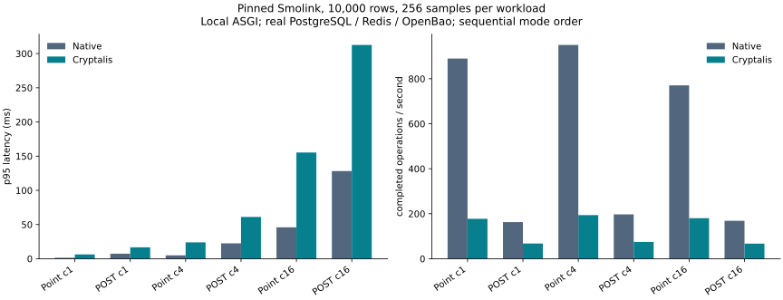

# Matched Smolink observations

These are local application observations, not production qualification or a competitor benchmark.

Original revision: `498d24bae999ed53ad85e1c1f1a09ea7fa151aa4`. Cryptalis wheel `0.1.0a1`, SHA-256 `eedecae8fd72a06bdf8ed95bd0aae377cabdfd51df325c50463f4f4f4b65060a`.

Both processes use the same Python 3.13.5 dependency environment, PostgreSQL 16 cluster, 10,000 committed seed rows and deterministic trace. The native run precedes migration and the protected run; mode order is not randomized. Each process warms 32 repository reads. OpenBao roots are warm during measurement. ASGI HTTP includes original middleware, dependencies, real Redis rate limiting, service, repository, commit and refresh; it excludes network/proxy/TLS latency. Each simulated guest sends at most eight requests. No rate limiter is disabled. Resource values cover the Python application, not total PostgreSQL/Redis/OpenBao CPU and memory. Background host contention was not controlled, and samples do not establish stable performance bounds.

| Workload | Native p50/p95/p99 ms | Protected p50/p95/p99 ms | Added p95 ms | Native/protected ops/s | Point target |
|---|---:|---:|---:|---:|---|
| repository_point_c1 | 1.035/1.397/2.788 | 5.300/6.245/8.966 | 4.849 | 889.8/177.4 | MISS |
| http_create_c1 | 5.793/7.318/9.753 | 14.484/16.651/18.520 | 9.333 | 162.7/67.6 | No write budget |
| repository_point_c4 | 3.874/4.956/17.378 | 20.109/23.923/35.012 | 18.968 | 950.4/193.9 | MISS |
| http_create_c4 | 20.030/22.534/25.749 | 53.308/61.136/69.287 | 38.602 | 197.2/74.5 | No write budget |
| repository_point_c16 | 16.698/45.913/66.924 | 81.830/155.339/178.329 | 109.426 | 770.6/180.0 | MISS |
| http_create_c16 | 88.023/128.181/150.466 | 220.214/312.690/318.211 | 184.509 | 168.7/67.1 | No write budget |

All measured repository-point concurrency cells miss the 3 ms added-p95 target. HTTP creates have no approved latency budget. Protected equality and IN-20 are unmeasured: this destination manifest is storage-only, and the original application exposes no such API operation. The 8 ms IN-20 target remains open.

| Workload | Native/protected CPU % of one core | Native/protected peak RSS MiB |
|---|---:|---:|
| repository_point_c1 | 91.4/96.2 | 100.2/112.5 |
| http_create_c1 | 81.3/91.6 | 101.7/113.9 |
| repository_point_c4 | 99.0/99.1 | 101.7/114.1 |
| http_create_c4 | 100.5/100.1 | 102.5/114.8 |
| repository_point_c16 | 98.0/99.2 | 102.7/115.9 |
| http_create_c16 | 100.6/100.2 | 104.0/116.8 |

| Storage observation | Native bytes | Protected bytes | Ratio |
|---|---:|---:|---:|
| destination_bytes | 880000 | 1330000 | 1.5114× |
| table_bytes | 1785856 | 5111808 | 2.8624× |
| all_index_bytes | 671744 | 1327104 | 1.9756× |
| total_relation_bytes | 2490368 | 6471680 | 2.5987× |

The storage table uses the snapshot before each benchmark. Column bytes use SUM(pg_column_size(destination)). Relation/index sizes are observed allocations without VACUUM FULL or REINDEX. They include dead-space/allocation history and are not compact steady-state sizes. No encrypted destination search index exists, so this does not qualify the 2× protected-column-plus-search-index target. The observed total allocation exceeds 2× and is retained.

Raw per-operation samples and process CPU/wall time are in native.json and protected.json. The initial host import failure is retained in ../native.log and its corrected preliminary run in ../native-retry.log; this folder contains the successful final pair. Neither successful measurement contains an API error. All benchmark-created rows were removed through the normal ORM; both runs return to the same 10,000 seed rows.

